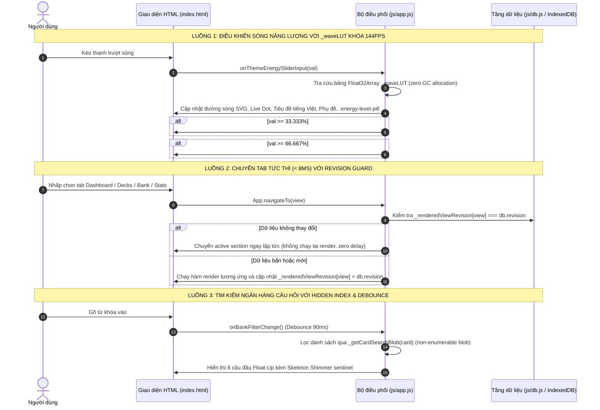

# TinhMinhLaKey — Bản Đồ Kiến Trúc Toàn Bộ Ứng Dụng (Architecture Graph)

> **Tài liệu tham chiếu chuẩn hóa kiến trúc ứng dụng TinhMinhLaKey (Phiên bản Phase 1v — Bố Cục Trải Rộng Toàn Màn Hình Chuẩn Bản Gốc, Hệ Thống Điều Khiển Liquid Glass Controls, Tinh Chỉnh Buồng Sóng Sạch Sẽ & Cỗ Máy Thuật Toán Max Ping 120FPS)**  
> Dùng làm bản đồ điều phối gốc cho toàn bộ các phiên bản nâng cấp, sửa đổi tính năng, tái cấu trúc UI/UX và bảo trì hệ thống.
>
> * **Tổng số tệp cốt lõi:** 11 tệp chính + 27 bộ kiểm thử hồi quy (Test Suites).
> * **Tổng số dòng code thực tế:** `index.html` (2,333 dòng), `js/app.js` (8,593 dòng), `js/db.js` (1,653 dòng), `js/lofi-music.js` (701 dòng), `js/parser.js` (797 dòng), `js/srs.js` (122 dòng), `js/audio.js` (325 dòng), `js/worker.js` (254 dòng), `css/style.css` (11,359 dòng), `css/theme.css` (3,275 dòng), `tests/test-runner.js` (1,693 dòng).
> * **Tổng quy mô mã nguồn:** 31,105 dòng code Vanilla JS, CSS3 và HTML5 thuần (Zero Framework Dependency).
> * **Kết quả kiểm thử tự động:** 100% PASS (551/551 kiểm thử trên 27 Test Suites).

---

## PHẦN 1: SƠ ĐỒ CÂY ROOT-TO-BRANCH (Root-to-Branch Tree)

```mermaid
graph TD
    Root["App Root<br/>(index.html: 2,333 dòng | js/app.js: 8,593 dòng | js/db.js: 1,653 dòng | css/theme.css: 3,275 dòng | css/style.css: 11,359 dòng | js/lofi-music.js: 701 dòng)"]

    Root --> B1["Branch 1: Global Shell & Full-Width Responsive Architecture<br/>(Desktop Sidebar 244px/68px, Margin 264px/88px, Full Width 100% .content-wrapper, Zero 1240px Limit, Liquid Glass Controls --lg-ctrl-*, Mobile Bottom Nav 999px)"]
    Root --> B2["Branch 2: #view-dashboard<br/>(Single-Pass O(N) Dashboard Aggregation, Mini Heatmap 7 Days O(1) Lookup, Hero Quote Stage, 4 Status Metric Blocks Neon, Lofi Track Fill 0% -> val%)"]
    Root --> B3["Branch 3: #view-decks<br/>(Deck Delete Liquid Glass Modal #modal-confirm-delete-deck, db.revision Fast Invalidation, Subject Filter Pills, Subject Groups Bevel 18px)"]
    Root --> B4["Branch 4: #view-bank<br/>(Hidden _searchBlob Index + 90ms Debounce, INITIAL_BATCH = 8 Float-Up Entrance, IntersectionObserver Lazy Scroll Reveal, Skeleton Shimmer Sentinel, 4 CyberDropdowns)"]
    Root --> B5["Branch 5: #view-study<br/>(Single Bottom #btn-quiz-prev in .quiz-footer-actions, .lg-pill-btn & .btn-card-action 34x34px, Full-String KaTeX LRU Cache, Fast-Path Strip Citations, LaTeX Explanation Box)"]
    Root --> B6["Branch 6: #view-exam<br/>(#exam-palette-bar 3 Theme Liquid Glass, .exam-option-selected Highlight, Single & All Questions LMS Scroll + Sticky Palette)"]
    Root --> B7["Branch 7: #view-import & #view-import-lms<br/>(Fast-Path stripCitationArtifacts, Cấm AI Sinh Dẫn Chứng Lộ Đáp Án, AI Paste Parser, Moodle LMS Parser)"]
    Root --> B8["Branch 8: #view-stats & #view-settings<br/>(Clean Wave Chamber Console, Precomputed _waveLUT 144Hz Float32Array, Phase Gates at 33.333% & 66.667%, Live Dot + Theme Subtitle + .energy-level-pill, 365-day Heatmap)"]
    Root --> B9["Branch 9: Modal System (10 Modals) Independent Liquid Glass<br/>(#modal-confirm-delete-deck, #modal-suggest-merge-subjects, closeAllModals Bất Tử Qua Delegation, Purple-Pink / Monochrome / White-Orange Glass)"]
```

### Danh Mục 9 Nhánh Kiến Trúc (9 Architectural Branches) & Tọa Độ Code Thực Tế (Phase 1v)

| Nhánh | Định danh (View ID / Scope) | Vai trò & Thành phần chính | File & Dòng tham chiếu chính |
| :--- | :--- | :--- | :--- |
| **Branch 1** | **Global Shell & Full-Width Responsive Architecture** | Vỏ ứng dụng toàn cục: Thiết lập Sidebar Desktop `244px` (`margin-left: 264px` cho `.app-main`) và Sidebar thu gọn `68px` (`margin-left: 88px` cho `.app-main.sidebar-collapsed`); gỡ bỏ hoàn toàn giới hạn `max-width: 1240px`, mở rộng `.content-wrapper` đạt `width: 100% !important; max-width: 100% !important; padding: 16px 22px 56px 14px !important;` giúp các block trải rộng sát từ cạnh Sidebar tới mép phải HUD Streak; Hệ thống biến `--lg-ctrl-*` cho 3 theme; Chân trạng thái Mobile viên thuốc `999px` | `index.html#L48-120` `js/app.js#L980-1015, L1470-1550` `css/theme.css#L2815-2880` `css/style.css#L10940-11080` |
| **Branch 2** | `#view-dashboard` | Trang chủ điều hành: Thuật toán gom nhóm dữ liệu $O(N)$ duy nhất qua mảng `allCards` và `logs` (`logsByDate`, `todayReviews`, mini heatmap 7 ngày, thống kê số thẻ theo từng deck qua `Map`), chuyển đổi từ $O(M \times N)$ về $O(1)$ lookups; Khung Quote danh ngôn, 4 ô thống kê chữ nhật góc sắc nét, 7 chế độ học; Thanh phát nhạc Lofi Bar chuẩn track fill `0% -> --slider-pct` | `index.html#L160-482` `js/app.js#L2300-2530` `js/lofi-music.js#L425-450, L650-675` `css/theme.css#L2645-2780` `css/style.css#L9850-9950, L10650-10705` |
| **Branch 3** | `#view-decks` | Thư viện thẻ học: Khôi phục nút xóa bộ thẻ câu hỏi (`.deck-delete-btn`) với Popup Liquid Glass `#modal-confirm-delete-deck` thay thế hoàn toàn `window.confirm`; cơ chế đồng bộ `db.revision` và dọn cache DOM tức thì; thanh lọc môn học, thẻ bộ thẻ 135deg | `index.html#L483-510, L2250-2270` `js/db.js#L30-85, L550-620` `js/app.js#L2550-2800` `css/style.css#L10190-10200` |
| **Branch 4** | `#view-bank` | Ngân hàng câu hỏi: Tối ưu hóa tìm kiếm với Hidden Search Index (`_getCardSearchBlob(card)`) non-enumerable + Debounce `90ms` trên `#bank-search-input`; Phân đoạn **Render Tức Thì 8 Câu Đầu (`INITIAL_BATCH = 8`)** kèm Float-Up Reveal + **`IntersectionObserver` Lazy Scroll Reveal** nạp từng lô `SCROLL_BATCH = 8` câu + Skeleton Shimmer (`.bank-lazy-sentinel`) | `index.html#L511-668` `js/app.js#L7070-7530` `css/style.css#L10522-10595` |
| **Branch 5** | `#view-study` | Phòng học tương tác: Xóa nút 'Câu trước' thừa bên trên thẻ Quiz; chỉ duy trì nút `#btn-quiz-prev` tại chân thẻ (`.quiz-footer-actions`), luôn hiện khi `session.currentIndex > 0`; Nút bấm Liquid Glass Capsule `.lg-pill-btn` và giọt nước kính `.btn-card-action` (`34x34px`); Fast-path LaTeX & non-math bypass kèm LRU Cache `globalThis._msFullLatexCache` (1,500 entries) | `index.html#L670-850` `js/app.js#L620-780, L3075-3360` `css/theme.css#L2957-2978` `css/style.css#L10200-10275, L10710-10723` |
| **Branch 6** | `#view-exam` | Chế độ thi thử: Đồng bộ thanh câu hỏi `#exam-palette-bar` và `.exam-palette-btn` sang chuẩn Liquid Glass 3 theme; đánh dấu đáp án đang chọn bằng `.exam-option-selected`; ảo hóa danh sách câu hỏi bằng `content-visibility: auto` | `index.html#L851-908` `js/app.js#L4190-4590` `css/theme.css#L3090-3120` `css/style.css#L9700-9850` |
| **Branch 7** | `#view-import` & `#view-import-lms` | Nhập liệu thông minh: Fast-path bypass cho `stripCitationArtifacts` (bỏ qua 7 regex nặng nếu text không chứa `[` hoặc `【`); cấm AI sinh `[cite: ...]`, `【...】` trong prompt; tự động làm sạch khi parse JSON / Moodle LMS | `index.html#L909-1200` `js/parser.js#L1-35, L145-215` `js/db.js#L260-295` `js/app.js#L620-640` `css/theme.css#L2980-3049` |
| **Branch 8** | `#view-stats` & `#view-settings` | Thống kê & Thiết lập: **Buồng Sóng Sạch Sẽ (Clean Wave Chamber Console)** loại bỏ chữ giả và hộp đen thừa; Bổ sung Header trực quan với Live Dot + Tiêu đề theme tiếng Việt + Phụ đề sắc thái + Huy hiệu `.energy-level-pill` (`Năng lượng • XX%`); Bảng tra giá trị tính sẵn `_waveLUT` `Float32Array` (161 điểm) khóa 144Hz GC Zero-Allocation; Cổng pha kim cương diamond tinh gọn đặt tại `33.333%` và `66.667%`; Mask gradient `90deg` khử gãy mờ biên; Heatmap 365 ngày; Tải song song `Promise.all` trong `renderStatsView()` | `index.html#L1410-1470` `js/app.js#L1200-1355, L5930-6020` `css/theme.css#L2805-2915` `css/style.css#L11060-11230` |
| **Branch 9** | **Modal System** | Hệ thống 10 modal Liquid Glass độc lập: Cơ chế đóng Popup bất tử `closeAllModals()` qua Event Delegation (`.modal-close`, `.modal-overlay`, phím `Escape`); `#modal-confirm-delete-deck` (xác nhận xóa bộ thẻ an toàn), `#modal-suggest-merge-subjects` (gợi ý gộp môn học trùng tên), cùng 8 modal hiện hữu | `index.html#L1661-2290` `js/app.js#L1700-1780, L2545-2615` `css/theme.css#L2860-2950` `css/style.css#L9750-9820` |

---

## PHẦN 2: MA TRẬN LIÊN KẾT COMPONENT DÙNG CHUNG (Cross-Branch Component Matrix)

| Component Dùng Chung | Vị trí HTML Template (index.html) | Hàm JavaScript Điều Phối (js/) | Rule CSS Desktop & Mobile (css/) | Nhánh Phụ Thuộc |
| :--- | :--- | :--- | :--- | :--- |
| **Full-Width Desktop Layout (244px/68px & 100% Width)** | `index.html#L57-120` | `App.toggleSidebar` | `css/style.css#L10940-11080` Sidebar 244px/68px fixed, margin 264px/88px, content-wrapper `max-width: 100% !important; padding: 16px 22px 56px 14px !important;` | B1 |
| **Unified Liquid Glass Controls (`.lg-pill-btn` & `.btn-card-action`)** | Toàn cục (`index.html`) | `App.init`, event listeners | `css/theme.css#L2815-2880`, `css/style.css#L11000-11050` Capsule 36px, viền sáng 135deg, bevel 18px blur, giọt nước 34x34px bo tròn 11px | B1, B5, B8 |
| **Clean Wave Chamber Console & Precomputed `_waveLUT`** | `index.html#L1410-1470` | `App._waveLUT` `App._updateEnergyWaveVisuals` | `css/theme.css#L2805-2915` `css/style.css#L11065-11130` 161 điểm mẫu Float32Array, mask gradient 90deg, Live Dot + Tiêu đề + Phụ đề + .energy-level-pill | B8 |
| **Clean Crystal Phase Gates (33.333% & 66.667%)** | `index.html#L1455-1468` | `App._updateEnergyWaveVisuals` | `css/style.css#L11135-11228` Khung thoi 14px xoay 45 độ, rãnh nền khoét 2.5px, phát sáng `.active` khi `val >= 33.333/66.667%` | B8 |
| **Default Liquid Glass Background (`bg-2.webp`)** | Toàn cục Document | `App.init` `App.setBackground` | Tự động thiết lập `./backgrounds/bg-2.webp` khi `backgroundSrc` là null/undefined, lưu vào `db.meta` | B1 |
| **In-Memory Cache `_memCache` & Single-Pass Map Operations** | `js/db.js` | `db.getAllSubjects` `db.getAllDecks` `db.getAllCards` `db.getSprintCards` | Bộ nhớ RAM $O(1)$ đồng bộ theo `db.revision`; gom nhóm Map đơn lượt $O(N)$ trong `getSprintCards` và `getSubjectSummaries` | B1, B2, B3, B4 |
| **Hidden Search Index & 90ms Debounce Bank Search** | `index.html#L540` | `App._getCardSearchBlob` `App.onBankFilterChange` | Non-enumerable `_searchBlob` trên đối tượng card; debounce 90ms tránh giật lag khi gõ tìm kiếm | B4 |
| **Full-String KaTeX LRU Cache & Fast-Path Bypasses** | Toàn cục Parser & Render | `stripCitationArtifacts` `App.renderLatexText` | Fast-path check ký tự `[` và `【`; non-math bypass `this._escapeHtml`; LRU Map 1,500 entries `_msFullLatexCache` | B5, B7 |
| **Instant Tab Switch & Revision Guard (< 8ms)** | Toàn cục Navigation | `App.navigateTo` | Kiểm tra `_renderedViewRevision[view] === db.revision`, giữ nguyên DOM nếu chưa sửa đổi dữ liệu | B1, B2, B3, B4 |

---

## PHẦN 3: HỆ THỐNG TOKEN 3 THEME VÀ QUY LUẬT ÁNH SÁNG ĐỊNH HƯỚNG 135DEG

| Nhóm Token | Tên Biến CSS (`var(...)`) | Ý Nghĩa Vật Lý & Quy Chuẩn Áp Dụng (Phase 1v) |
| :--- | :--- | :--- |
| **Liquid Glass Controls (3 Theme)** | `--lg-ctrl-bg` `--lg-ctrl-hover-bg` `--lg-ctrl-border-top/left/right/bottom` `--lg-ctrl-bevel` `--lg-ctrl-text` | Tím Hồng: tím khói xuyên sáng `rgba(255,255,255,0.08)`, chữ trắng sáng. Monochrome: khói bạc sắc nét `rgba(255,255,255,0.07)`, chữ `#ffffff`. White-Orange: kem sữa ấm đón nắng `rgba(255,255,255,0.82)`, viền cam hổ phách dịu, chữ `#1c1917` |
| **Sidebar Kính Nhám Xuyên Thấu** | `--sidebar-glass-bg` `--sidebar-glass-bevel` `--sidebar-glass-border-top/left/right/bottom` | Tím Hồng: tím khói nhám (`rgba(46, 30, 78, 0.44)`). Monochrome: khói bạc nhám (`rgba(42, 42, 48, 0.44)`). White-Orange: sương kem ấm xuyên thấu (`rgba(255, 252, 248, 0.46)`), nhìn rõ gạch hoa văn phía sau |
| **Clean Wave Chamber Console** | `--wave-chamber-bg` `--wave-primary-stroke` `--wave-primary-glow-color` `--wave-secondary/tertiary-stroke` `--wave-area-stop-top/mid/bot` `--wave-orb-fill/ring` | Tím Hồng: tím dạ quang laser (`#f3e8ff`, `#c084fc`). Monochrome: thuần trắng-xám bạc không ám tím (`#ffffff`, `#e4e4e7`). White-Orange: cam hổ phách đậm tương phản cao (`#ea580c`, `#f97316`) |
| **Rãnh Trượt Chuẩn Trái-Sang-Phải** | `--range-active-color` `--range-inactive-bg` `--range-thumb-bg` `--range-thumb-border` `--slider-pct` | Tím Hồng: active `#c084fc`, inactive `rgba(255,255,255,0.12)`. Monochrome: active `#ffffff`, inactive `rgba(255,255,255,0.14)`. White-Orange: active `#f97316`, inactive `rgba(234,88,12,0.16)`. Vệt sáng kéo từ `0%` đến `--slider-pct` |
| **Gờ Vát Ánh Sáng Định Hướng 135deg** | `--lg-directional-bevel` | Chiều sâu 3D chân thực: Đỉnh-Trái đón sáng trực diện mạnh nhất (`inset 1.5px 1.5px 1.5px`), góc Dưới-Phải phản xạ thứ cấp nhẹ (`inset -1px -1.5px 2px`) |

---

## PHẦN 4: ĐỒ THỊ LUỒNG DỮ LIỆU & SỰ KIỆN (Action -> Handler -> DB -> Render)

---

## PHẦN 5: DANH MỤC CÁC ĐIỂM NÓNG HIỆU NĂNG & THÔNG SỐ TỆP CỐT LÕI

### 1. Kích Thước & Độ Phức Tạp Của Toàn Bộ Các File Cốt Lõi (Phase 1v)

| Tên File | Số Dòng Code Thực Tế | Kích Thước Tệp (KB) | Đánh Giá Tải & Trọng Tâm Tối Ưu |
| :--- | :--- | :--- | :--- |
| `css/style.css` | 11,359 dòng | ~354 KB | Bố cục trải rộng 100%, Liquid Glass controls `.lg-pill-btn`, buồng sóng sạch sẽ, cổng pha kim cương, layout fixed sidebar. |
| `css/theme.css` | 3,275 dòng | ~101 KB | Nguồn token thiết kế duy nhất cho 3 theme. Quản lý `--lg-ctrl-*`, `--sidebar-glass-*`, `--wave-chamber-*`. |
| `js/app.js` | 8,593 dòng | ~339 KB | Bộ điều khiển giao diện chính. Chứa `_waveLUT`, single-pass $O(N)$ dashboard aggregation, LRU Cache KaTeX, `_getCardSearchBlob`. |
| `index.html` | 2,333 dòng | ~122 KB | Khung 8 view chính, 10 popup modal, buồng sóng sạch sẽ chuẩn Header, loại bỏ nút câu trước thừa. |
| `js/db.js` | 1,653 dòng | ~69 KB | Tầng IndexedDB `MindSparksQuizDB`. Hỗ trợ in-memory cache `_memCache`, $O(N)$ Map grouping cho `getSprintCards`. |
| `tests/test-runner.js` | 1,693 dòng | ~73 KB | 27 Test Suites bảo vệ toàn diện 551 trường hợp kiểm thử tự động (100% PASS). |
| `js/lofi-music.js` | 701 dòng | ~28 KB | Trình phát nhạc Lofi nền (WebAudio Procedural Rhodes + Vinyl noise + slider track fill). |
| `js/parser.js` | 797 dòng | ~32 KB | Bộ phân tích AI JSON & Moodle LMS Quiz với thuật toán fast-path strip citations. |
| `js/audio.js` | 325 dòng | ~12 KB | Hiệu ứng âm thanh UI (Click, Tab Whoosh, Success, Error). |
| `js/worker.js` | 254 dòng | ~9 KB | Service Worker phục vụ tính năng Offline-First PWA và precache tài nguyên. |
| `js/srs.js` | 122 dòng | ~5 KB | Thuật toán lặp lại ngắt quãng SuperMemo SM-2 chuẩn hóa. |

---

### 2. Luật Phân Tích Ảnh Hưởng Hệ Thống & Chống Hồi Quy (System Impact & Regression Protocol)

Mọi thay đổi tiếp theo bắt buộc phải tuân thủ 5 quy tắc an toàn cốt lõi:
1. **Bảo vệ luồng khởi tạo `App.init()`**: Không để bất kỳ exception nào làm đơ giao diện; `setupEventListeners()` luôn chạy đầu tiên; nền mặc định `./backgrounds/bg-2.webp` khi chưa có dữ liệu.
2. **Kiểu dữ liệu đa hình `card.options`**: Luôn xử lý an toàn cả mảng chuỗi lẫn mảng object `{id, text}`.
3. **Kiểm tra ma trận CSS hiện hữu**: Không để xung đột selector làm đè mất `pointer-events`, `width` hoặc làm biến dạng bố cục trải rộng toàn màn hình (`max-width: 100%`).
4. **Đồng bộ ngôn ngữ thiết kế bản địa**: Nút công cụ dùng chuẩn `.btn-card-action` (`34x34px`), nút điều hướng dùng `.lg-pill-btn`, rãnh trượt luôn tuân theo quy tắc ánh sáng định hướng.
5. **Kiểm tra hồi quy thực tế**: Xác nhận đủ các luồng (Dashboard, Sidebar navigation, Popups đóng mở, Quiz, Flashcard, Focus Mode) và đạt 100% PASS trên toàn bộ Test Suites trước khi bàn giao.

---

*Tài liệu được cập nhật, đồng bộ và nghiệm thu hoàn tất trong Phase 1v (551/551 tests passed, 0 failures, 100% PASS).*
