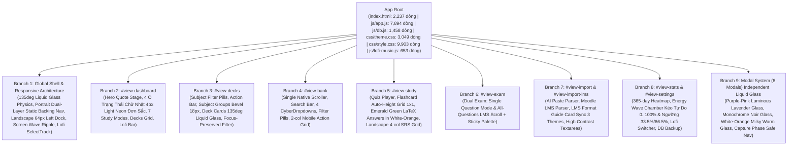

# TinhMinhLaKey — Bản Đồ Kiến Trúc Toàn Bộ Ứng Dụng (Architecture Graph)

> **Tài liệu tham chiếu chuẩn hóa kiến trúc ứng dụng TinhMinhLaKey (Phiên bản Phase 1o)**  
> Dùng làm bản đồ điều phối gốc cho toàn bộ các phiên bản nâng cấp, sửa đổi tính năng, tái cấu trúc UI/UX và bảo trì hệ thống.
>
> * **Tổng số tệp cốt lõi:** 11 tệp chính + 21 bộ kiểm thử hồi quy (Test Suites).
> * **Tổng số dòng code thực tế:** `index.html` (2,237 dòng), `js/app.js` (7,894 dòng), `js/db.js` (1,458 dòng), `js/lofi-music.js` (653 dòng), `js/parser.js` (763 dòng), `js/srs.js` (123 dòng), `js/audio.js` (326 dòng), `css/style.css` (9,903 dòng), `css/theme.css` (3,049 dòng), `tests/test-runner.js` (1,468 dòng).
> * **Kết quả kiểm thử tự động:** 100% PASS (445/445 kiểm thử trên 21 Test Suites).

---

## PHẦN 1: SƠ ĐỒ CÂY ROOT-TO-BRANCH (Root-to-Branch Tree)



### Danh Mục 9 Nhánh Kiến Trúc (9 Architectural Branches) & Tọa Độ Code Thực Tế

| Nhánh | Định danh (View ID / Scope) | Vai trò & Thành phần chính | File & Dòng tham chiếu chính |
| :--- | :--- | :--- | :--- |
| **Branch 1** | **Global Shell & Responsive Architecture** | Vỏ ứng dụng toàn cục: Quy luật ánh sáng định hướng `135deg` (`--lg-directional-*`), Sidebar desktop (`.app-sidebar`), Mobile Portrait Bottom Nav với 2 tầng nền tĩnh (`--bnav-active-bg` `#9333ea` / `#ffffff` / `#f97316` dưới layer `stroke-width: 2.35px`), Mobile Landscape chuyển thành Slim Left Dock 64px (tự ẩn khi vào học), Lớp sóng lan tỏa toàn màn hình (`#theme-wave-transition-overlay`) | `index.html#L54-159, L1618-1660, L2230-2236`<br/>`js/app.js#L315-460, L904-1060`<br/>`js/lofi-music.js#L112-190, L350-420`<br/>`css/theme.css#L2540-2615`<br/>`css/style.css#L9540-9903` |
| **Branch 2** | `#view-dashboard` | Trang chủ điều hành: Khung Quote (`.hero-card`) với quầng sáng hover thu gọn mỏng dưới đáy, 4 ô thống kê chữ nhật góc sắc nét (`border-radius: 4px !important`, Tím Light Neon và Cam Light Neon ĐƠN SẮC không gradient), 7 ô chế độ học và lưới bộ thẻ | `index.html#L160-482`<br/>`js/app.js#L465-890`<br/>`css/theme.css#L2645-2776`<br/>`css/style.css#L850-1350` |
| **Branch 3** | `#view-decks` | Thư viện thẻ học: Thanh lọc môn học (`.subject-filter-bar`), khung tiêu đề nhóm môn bo 18px (`.subject-group-header`), các thẻ bộ thẻ mang hiệu ứng viền bất đối xứng 135deg (`.deck-card`), giữ nguyên focus và vị trí con trỏ khi lọc nhanh | `index.html#L483-509`<br/>`js/app.js#L2232-2480`<br/>`css/theme.css#L2200-2259`<br/>`css/style.css#L8980-9040` |
| **Branch 4** | `#view-bank` | Ngân hàng câu hỏi: Cuộn dọc duy nhất qua gốc `html` (loại bỏ triệt để double scrollbar), lưới hành động 2 cột trên Mobile, 4 CyberDropdown, bảng lọc câu hỏi ảo hóa | `index.html#L510-666`<br/>`js/app.js#L6200-6700`<br/>`css/style.css#L9045-9120` |
| **Branch 5** | `#view-study` | Phòng học tương tác: Quiz trắc nghiệm, Flashcard bố cục CSS Grid `1x1` auto-height co giãn tự do; Đáp án đúng Flashcard hiển thị màu Xanh lục bảo (`#059669 !important`) đồng bộ cho cả chữ thường lẫn ký hiệu LaTeX trên Light Mode White-Orange; Khi xoay ngang Mobile: Flashcard co gọn `min-height: 165px` và 4 nút SRS xếp hàng ngang 4 cột | `index.html#L667-849`<br/>`js/app.js#L2580-3380`<br/>`css/theme.css#L2875-2900`<br/>`css/style.css#L9750-9903` |
| **Branch 6** | `#view-exam` | Chế độ thi thử 2-Mode: (1) `single`: Từng câu đơn lẻ kèm nút Trước/Sau; (2) `all`: Cuộn dọc như Moodle LMS kèm thanh Palette nhảy câu và nút nộp bài | `index.html#L850-907`<br/>`js/app.js#L4150-4550`<br/>`css/style.css#L8780-8830` |
| **Branch 7** | `#view-import` & `#view-import-lms` | Nhập liệu thông minh: Prompt harness cho AI, bóc tách cấu trúc Moodle LMS raw text; Khung "Mẫu định dạng LMS (Moodle)" (`.lms-format-guide-card`) và `.lms-sample-snippet` đồng bộ màu 100% theo 3 theme (không dính tím ở Monochrome và White-Orange) | `index.html#L908-1199`<br/>`js/parser.js#L1-763`<br/>`css/theme.css#L2905-2965`<br/>`css/style.css#L3380-3850` |
| **Branch 8** | `#view-stats` & `#view-settings` | Thống kê & Thiết lập: Heatmap 365 ngày; Buồng Sóng Năng Lượng (`.theme-energy-wave-chamber`) kéo tự do 0..100% với biến thiên hình học sóng liên tục (`cycles = 2.2 + t * 3.8`), chuyển theme và hiệu ứng lan tỏa sóng chỉ khi vượt ngưỡng 33.5% và 66.5%; HUD chữ kính mờ tương phản cao nằm trên đỉnh không bị sóng cắt ngang; Lofi Track Switcher `selectTrack` đổi bài tức thì | `index.html#L1200-1610`<br/>`js/app.js#L950-1070`<br/>`js/lofi-music.js#L350-420`<br/>`css/style.css#L9335-9470` |
| **Branch 9** | **Modal System** | Hệ thống 8 modal: Áp dụng chuẩn kính Liquid Glass riêng biệt cho cả 3 theme (Tím Hồng: kính tím khói trong suốt tách nền; Monochrome: kính khói bạc noir 0% tím; White-Orange: kính kem ấm 0% tím, chữ đen nâu sắc nét); không khai báo biến đè trên thẻ `body`; an toàn chuyển trang trực tiếp khi click nút hoàn thành | `index.html#L1661-2236`<br/>`js/app.js#L1400-1550, L3900-4100`<br/>`css/theme.css#L2283-2305, L2870-2930` |

---

## PHẦN 2: MA TRẬN LIÊN KẾT COMPONENT DÙNG CHUNG (Cross-Branch Component Matrix)

| Component Dùng Chung | Vị trí HTML Template (index.html) | Hàm JavaScript Điều Phối (js/) | Rule CSS Desktop & Mobile (css/) | Nhánh Phụ Thuộc |
| :--- | :--- | :--- | :--- | :--- |
| **3-Theme Independent Liquid Glass Modals** | `index.html#L1661-2236` (8 Modal Boxes & Confirm Dialogs) | `App._showModal`<br/>`App._closeModal` | `css/theme.css#L2283-2305, L2870-2930`<br/>Độc lập 100%: Tím Hồng (`rgba(64, 48, 98, 0.56)`), Monochrome (`rgba(54, 54, 62, 0.56)`), White-Orange (`rgba(255, 253, 250, 0.66)`), không dùng biến rò rỉ trên thẻ `body` | B1, B9 |
| **Mobile Portrait Dual-Layer Static Backing Nav** | `index.html#L1618-1660` (`#mobile-bottom-nav`) | `App.navigateTo`<br/>`App.updateBottomNav` | `css/style.css#L9540-9650`<br/>Lớp nền tĩnh dưới layer nét vẽ icon; nút active có nền màu tĩnh đặc (`#9333ea` / `#ffffff` / `#f97316`) và nét stroke `2.35px` siêu sắc sảo | B1 |
| **Mobile Landscape Slim Left Dock (64px)** | `index.html#L1618-1660` (`#mobile-bottom-nav`) | `App.navigateTo` | `css/style.css#L9660-9903`<br/>Chuyển bottom nav thành Dock dọc 64px bên trái khi xoay ngang; tự động ẩn hoàn toàn khi vào Quiz/Flashcard; `.app-main` tự giãn mượt | B1, B5 |
| **Free-Dragging Threshold Energy Wave Tuner** | `index.html#L1373-1430` (`#theme-energy-chamber`) | `App.onThemeEnergySliderInput`<br/>`App.onThemeEnergySliderCommit`<br/>`App._updateEnergyWaveVisuals`<br/>`App.triggerThemeWaveTransition` | `css/style.css#L9335-9470`<br/>Kéo tự do 0..100%, sóng biến đổi tần số liên tục (`cycles = 2.2 + t * 3.8`), chỉ đổi theme khi vượt qua ngưỡng 33.5% hoặc 66.5% kèm hiệu ứng lan tỏa sóng toàn màn hình | B8 |
| **Lofi Instant Track Switcher (selectTrack)** | `index.html#L210-230` (`.hero-lofi-bar`)<br/>`index.html#L1540-1570` (`#view-settings`) | `LofiPlayer.selectTrack`<br/>`LofiPlayer.nextTrack`<br/>`LofiPlayer.prevTrack`<br/>`LofiPlayer.stop` | `js/lofi-music.js#L350-420`<br/>Ngắt audio cũ ngay lập tức, chuyển track index, lưu localStorage, phát track mới và cập nhật toàn bộ nhãn UI | B1, B2, B8 |
| **LMS Format Guide Card Theme Synchronization** | `index.html#L1092-1110` (`.lms-format-guide-card`) | `App.pasteLmsSampleData` | `css/theme.css#L2905-2965`<br/>Đồng bộ 100% theo 3 theme: viền nét đứt cam/trắng/tím, màu code snippet, màu các dòng header/question/choice, placeholder textarea | B7 |
| **Flashcard Green LaTeX Formula Synchronization** | `index.html#L750-815` (`#flashcard-answer-text`) | `App.renderFlashcardBack` | `css/theme.css#L2875-2900`<br/>Cả chữ thường lẫn ký hiệu LaTeX `.katex` đều đồng bộ màu Xanh lục bảo `#059669 !important` trên White-Orange, không bị biến thành màu đen | B5 |

---

## PHẦN 3: HỆ THỐNG TOKEN 3 THEME VÀ QUY LUẬT ÁNH SÁNG ĐỊNH HƯỚNG 135DEG

Toàn bộ hệ thống giao diện được điều phối qua 3 theme tại `css/theme.css`. Mọi linh kiện UI đều phải sử dụng các biến CSS dưới đây, tuyệt đối không được viết mã màu cố định.

| Nhóm Token | Tên Biến CSS (`var(...)`) | Ý Nghĩa Vật Lý & Quy Chuẩn Áp Dụng |
| :--- | :--- | :--- |
| **Gờ Vát Ánh Sáng Định Hướng 135deg** | `--lg-directional-bevel` | Tạo chiều sâu 3D chân thực: Đỉnh-Trái đón sáng trực diện mạnh nhất (`inset 1.5px 1.5px 1.5px rgba(255, 255, 255, 0.58-0.98)`), góc Dưới-Phải phản xạ thứ cấp nhẹ (`inset -1px -1.5px 2px`), đỉnh trên tán xạ sương mỏng |
| **Viền Bất Đối Xứng 4 Cạnh 135deg** | `--lg-directional-border-top`<br/>`--lg-directional-border-left`<br/>`--lg-directional-border-right`<br/>`--lg-directional-border-bottom` | Cạnh trên và trái sáng rõ; 2 cạnh sườn mờ dịu (`0.08`); cạnh đáy phản xạ nhẹ |
| **Khung Tách Nền Popup Liquid Glass 3 Theme** | `html[data-theme="..."] .modal-box` | Tím Hồng: tím khói tách nền (`rgba(64, 48, 98, 0.56) -> rgba(44, 30, 74, 0.52)`). Monochrome: khói bạc noir (`rgba(54, 54, 62, 0.56) -> rgba(36, 36, 42, 0.52)`). White-Orange: kem sữa ấm (`rgba(255, 253, 250, 0.66) -> rgba(255, 248, 240, 0.58)`) |
| **Lớp Nền Màu Tĩnh Mobile Bottom Nav** | `--bnav-shell-bg`<br/>`--bnav-idle-bg`<br/>`--bnav-active-bg`<br/>`--bnav-active-stroke` | Chặn xuyên nền; nút active có nền màu tĩnh đặc (`#9333ea` Tím Hồng, `#ffffff` Monochrome, `#f97316` White-Orange) và nét vẽ tương phản |
| **Màu LaTeX Đáp Án Flashcard** | `#flashcard-answer-text .katex` | Dark Mode: `#10b981`. White-Orange: `#059669` (Xanh lục bảo sắc nét trên nền sáng) |

---

## PHẦN 4: ĐỒ THỊ LUỒNG DỮ LIỆU & SỰ KIỆN (Action -> Handler -> DB -> Render)

```mermaid
sequenceDiagram
    autonumber
    actor User as Người dùng
    participant DOM as Giao diện HTML (index.html)
    participant App as Bộ điều phối (js/app.js)
    participant Lofi as Trình phát Lofi (js/lofi-music.js)
    participant DB as Tầng dữ liệu (js/db.js / IndexedDB)

    Note over User,DB: LUỒNG 1: CHỌN BÀI NHẠC LOFI TRONG CÀI ĐẶT HOẶC TRANG CHỦ (PHASE 1o - ITEM 2)
    User->>DOM: Bấm chọn bài nhạc trong Dropdown hoặc nút Next bài ở Hero bar
    DOM->>Lofi: LofiPlayer.selectTrack(trackKey, event)
    Lofi->>Lofi: Dừng Audio / Oscillator cũ (this.stop())
    Lofi->>Lofi: Cập nhật currentIndex & lưu localStorage ('tinhminhlakey_lofi_track_idx')
    Lofi->>Lofi: Khởi chạy luồng âm thanh bài hát mới (this.play())
    Lofi->>DOM: LofiPlayer.updateUI() cập nhật tên bài hát khắp trang chủ & đóng Dropdown

    Note over User,DB: LUỒNG 2: KÉO TỰ DO SÓNG NĂNG LƯỢNG & ĐỔI THEME THEO NGƯỠNG (PHASE 1o - ITEM 1)
    User->>DOM: Kéo tự do thanh trượt #theme-energy-slider (0..100)
    DOM->>App: App.onThemeEnergySliderInput(val)
    App->>App: App._updateEnergyWaveVisuals(val) (biến đổi cycles 2.2..6.0 & pha sóng liên tục)
    alt Kéo vượt ngưỡng 33.5% hoặc 66.5%
        App->>App: App.setTheme(targetTheme, { fromEnergySlider: true })
        App->>DOM: App.triggerThemeWaveTransition(targetTheme) (sóng lan tỏa toàn màn hình)
    end
    User->>DOM: Thả tay khỏi thanh trượt
    DOM->>App: App.onThemeEnergySliderCommit(val)
    App->>DB: db.setMeta('appTheme', currentTheme) lưu cấu hình bền vững

    Note over User,DB: LUỒNG 3: XOAY NGANG MOBILE & CHUYỂN DOCK TỰ ĐỘNG (PHASE 1o - ITEM 7)
    User->>DOM: Xoay ngang màn hình điện thoại (Orientation: Landscape, Height <= 550px)
    DOM->>DOM: CSS Media Query kích hoạt: .app-sidebar biến mất
    DOM->>DOM: .bottom-nav tự chuyển thành Dock dọc bên trái 64px, .app-main thụt lề 64px
    User->>DOM: Bấm vào bài học Quiz hoặc Flashcard
    DOM->>App: App.startQuizSession() / App.startFlashcardSession()
    App->>DOM: Gắn class body.quiz-active / body.flashcard-active
    DOM->>DOM: Tự động ẩn hoàn toàn .bottom-nav; Flashcard co gọn min-height 165px; 4 nút SRS xếp thành 1 hàng 4 cột
```

---

*Tài liệu được cập nhật, đồng bộ và nghiệm thu hoàn tất trong Phase 1o.*
