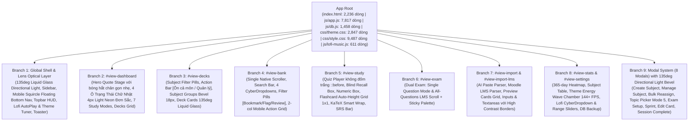
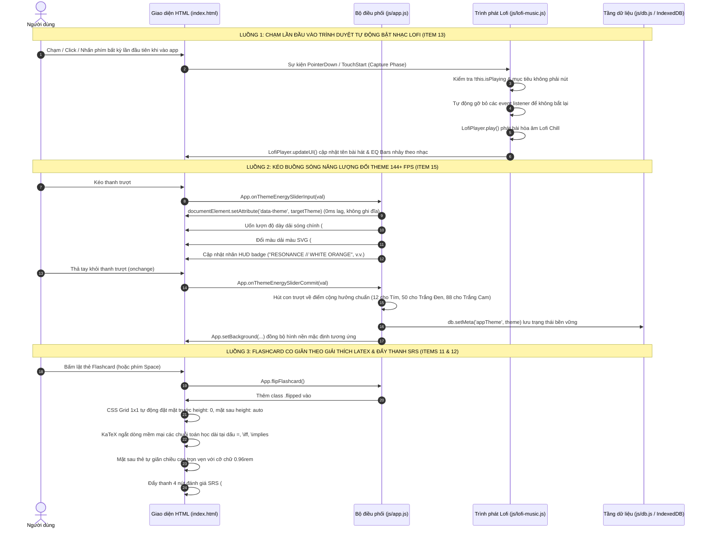

# TinhMinhLaKey — Bản Đồ Kiến Trúc Toàn Bộ Ứng Dụng (Architecture Graph)

> **Tài liệu tham chiếu chuẩn hóa kiến trúc ứng dụng TinhMinhLaKey (Phiên bản Phase 1n)**  
> Dùng làm bản đồ điều phối gốc cho toàn bộ các phiên bản nâng cấp, sửa đổi tính năng, tái cấu trúc UI/UX và bảo trì hệ thống.
>
> * **Tổng số tệp cốt lõi:** 11 tệp chính + 20 bộ kiểm thử hồi quy (Test Suites).
> * **Tổng số dòng code thực tế:** `index.html` (2,236 dòng), `js/app.js` (7,817 dòng), `js/db.js` (1,458 dòng), `js/lofi-music.js` (611 dòng), `js/parser.js` (763 dòng), `js/srs.js` (123 dòng), `js/audio.js` (326 dòng), `css/style.css` (9,487 dòng), `css/theme.css` (2,847 dòng), `tests/test-runner.js` (1,421 dòng).
> * **Kết quả kiểm thử tự động:** 100% PASS (421/421 kiểm thử trên 20 Test Suites).

---

## PHẦN 1: SƠ ĐỒ CÂY ROOT-TO-BRANCH (Root-to-Branch Tree)

### Danh Mục 9 Nhánh Kiến Trúc (9 Architectural Branches) & Tọa Độ Code Thực Tế

| Nhánh | Định danh (View ID / Scope) | Vai trò & Thành phần chính | File & Dòng tham chiếu chính |
| :--- | :--- | :--- | :--- |
| **Branch 1** | **Global Shell & Lens Layer** | Vỏ ứng dụng toàn cục: Quy luật ánh sáng định hướng `135deg` (`--lg-directional-*`), Sidebar desktop (`.app-sidebar`), Mobile bottom bar (`.bottom-nav` squircle nổi 62px, màu cam `#ea580c` ở White-Orange), Khóa bảo vệ SVG icon nét mảnh đơn sắc, Single Document Scroller (`html`), Lofi Player chạm lần đầu tự phát | `index.html#L54-159, L1618-1660` `js/app.js#L315-460, L904-1060` `js/lofi-music.js#L112-160` `css/theme.css#L2530-2590` `css/style.css#L8840-8960` |
| **Branch 2** | `#view-dashboard` | Trang chủ điều hành: Khung Quote (`.hero-card`) với quầng sáng hover thu gọn mỏng dưới đáy, 4 ô thống kê chữ nhật góc sắc nét (`border-radius: 4px !important`, Tím Light Neon và Cam Light Neon ĐƠN SẮC không gradient), 7 ô chế độ học và lưới bộ thẻ | `index.html#L160-482` `js/app.js#L465-890` `css/theme.css#L2595-2740` `css/style.css#L850-1350` |
| **Branch 3** | `#view-decks` | Thư viện thẻ học: Thanh lọc môn học (`.subject-filter-bar`), khung tiêu đề nhóm môn bo 18px (`.subject-group-header`), các thẻ bộ thẻ mang hiệu ứng viền bất đối xứng 135deg (`.deck-card`), giữ nguyên focus và vị trí con trỏ khi lọc nhanh | `index.html#L483-509` `js/app.js#L2232-2480` `css/theme.css#L2200-2259` `css/style.css#L8980-9040` |
| **Branch 4** | `#view-bank` | Ngân hàng câu hỏi: Cuộn dọc duy nhất qua gốc `html` (loại bỏ triệt để double scrollbar), lưới hành động 2 cột trên Mobile (không tràn chữ "Sao chép Prompt AI viết lại"), 4 CyberDropdown, bảng lọc câu hỏi ảo hóa | `index.html#L510-666` `js/app.js#L6200-6700` `css/style.css#L9045-9120` |
| **Branch 5** | `#view-study` | Phòng học tương tác: Quiz trắc nghiệm đã xóa sạch đốm trắng trung tâm (`::before`), Flashcard bố cục CSS Grid `1x1` auto-height co giãn tự do không đè thanh SRS, KaTeX tự động ngắt dòng thông minh (`.katex-html > .base::after { content: "\200B"; }`), cỡ chữ giải thích chuẩn `0.96rem` | `index.html#L667-849` `js/app.js#L2580-3380` `css/style.css#L7138-7150, L9125-9275` |
| **Branch 6** | `#view-exam` | Chế độ thi thử 2-Mode: (1) `single`: Từng câu đơn lẻ kèm nút Trước/Sau; (2) `all`: Cuộn dọc như Moodle LMS kèm thanh Palette nhảy câu và nút nộp bài | `index.html#L850-907` `js/app.js#L4150-4550` `css/style.css#L8780-8830` |
| **Branch 7** | `#view-import` & `#view-import-lms` | Nhập liệu thông minh: Prompt harness cho AI, bóc tách cấu trúc Moodle LMS raw text, thẻ xem trước câu hỏi có CyberDropdown chọn kiểu/độ khó, các khung nhập liệu và textarea viền sáng sắc nét trên nền tối | `index.html#L908-1199` `js/parser.js#L1-763` `css/style.css#L3380-3850` |
| **Branch 8** | `#view-stats` & `#view-settings` | Thống kê & Thiết lập: Heatmap 365 ngày, Buồng Sóng Năng Lượng Quang Phổ Tương Tác (`.theme-energy-wave-chamber`) kéo thanh trượt đổi theme 144+ FPS không lag, chọn bài Lofi bằng CyberDropdown đồng bộ toàn app, thanh kéo âm lượng đổi màu theo 3 theme | `index.html#L1200-1610` `js/app.js#L950-1070` `js/lofi-music.js#L540-600` `css/theme.css#L2745-2810` `css/style.css#L9280-9485` |
| **Branch 9** | **Modal System** | Hệ thống 8 modal: Đã xóa sạch sọc kính chia Fluted Glass, Popup Theme Tím Hồng được nâng cấp nền tách lớp (`--popup-glass-volume-bg`) và gờ viền sáng (`--popup-glass-rim-border`) như 2 theme kia; sự kiện Capture Phase cho phép chuyển trang trực tiếp khi hoàn thành bài | `index.html#L1661-2236` `js/app.js#L1400-1550, L3900-4100` `css/theme.css#L2515-2530` |

---

## PHẦN 2: MA TRẬN LIÊN KẾT COMPONENT DÙNG CHUNG (Cross-Branch Component Matrix)

Khi chỉnh sửa bất kỳ Component dùng chung nào, kỹ sư / Agent **phải đối chiếu toàn bộ các nhánh trong bảng ma trận này** để không làm sót giao diện hoặc gây gãy vỡ layout chéo.

| Component Dùng Chung | Vị trí HTML Template (index.html) | Hàm JavaScript Điều Phối (js/) | Rule CSS Desktop & Mobile (css/) | Nhánh Phụ Thuộc |
| :--- | :--- | :--- | :--- | :--- |
| **135deg Directional Liquid Glass (Cards & Modals)** | `index.html#L160-482` (`.hero-card`, `.stat-card`, `.study-mode-card`) `index.html#L1661-2236` (8 Modal Boxes) | `App.updateHeroQuote` `App._showModal` `App._closeModal` | `css/theme.css#L2530-2590` `border-top`, `border-left`, `border-right`, `border-bottom` bất đối xứng theo hướng sáng; viền trên-trái đón sáng rực rỡ, hai cạnh bên mờ dịu, góc dưới-phải phản xạ nhẹ | B1, B2, B3, B9 |
| **4 Rectangular Stat Cards (Solid Light Neon)** | `index.html#L180-240` (4 ô thống kê dưới Quote) | `App.renderStatsOverview` `App.updateHeroQuote` | `css/theme.css#L2625-2740` `border-radius: 4px !important;` trên cả 3 theme. Hover Purple-Pink: Tím Light Neon (`rgba(192, 132, 252, 0.28)`). Hover White-Orange: Cam Light Neon **đơn sắc** (`rgba(255, 158, 88, 0.28)`), zero gradient | B2 |
| **Mobile Floating Squircle Bottom Nav** | `index.html#L1618-1660` (`#mobile-bottom-nav`) | `App.navigateTo` `App.updateBottomNav` | `css/style.css#L8850-8960` Cao 62px, bo squircle 20px, `backdrop-filter: blur(26px)`. Ở White-Orange, nút active mang chữ và icon màu Cam Đậm (`#ea580c`), không chìm lóa trên nền sáng | B1 |
| **Flashcard Auto-Height Grid 1x1 & KaTeX Smart Wrap** | `index.html#L750-815` (`#flashcard-player-wrap`) | `App.flipFlashcard` `App.rateFlashcard` `App.renderFlashcardBack` | `css/style.css#L9125-9275` `.flashcard-card` grid 1x1 auto-height giãn nở theo nội dung giải thích, đẩy 4 nút SRS xuống dưới (tuyệt đối không bao giờ đè lên nút). KaTeX tự ngắt dòng sau `=`, `\iff`, `\implies` qua `\200B` | B5 |
| **CyberDropdown System** | `index.html#L510-580` (Bank) `index.html#L920-960` (Import) `index.html#L1550-1560` (Lofi Track Settings) `index.html#L1700-2100` (Modals) | `App._toggleCyberDropdownById` `App.closeAllCyberDropdowns` `LofiPlayer.initCyberDropdown` | `css/style.css#L7230-7350` Dropdown tùy chỉnh nổi bật với z-index cao nhất, hỗ trợ keyboard accessibility và đánh dấu `.active` bài hát/mục được chọn | B1, B4, B7, B8, B9 |
| **Interactive Resonance Energy Wave Theme Tuner** | `index.html#L1373-1430` (`#theme-energy-chamber`) | `App.syncThemeEnergyChamber` `App.onThemeEnergySliderInput` `App.onThemeEnergySliderCommit` `App.selectThemeViaEnergyWave` | `css/style.css#L9280-9485` Sóng SVG Multi-Harmonic uốn lượn đổi màu tức thời theo vị trí con trượt, chuyển theme mượt 144+ FPS và tự hút về các mốc cộng hưởng chuẩn (12, 50, 88) | B8 |
| **Lofi Background Music & First-Touch AutoPlay** | `index.html#L210-230` (`.hero-lofi-bar`) `index.html#L1540-1570` (`#view-settings`) | `LofiPlayer.init` `LofiPlayer.setupFirstInteractionAutoPlay` `LofiPlayer.selectTrack` | `js/lofi-music.js#L112-160, L540-600` `css/theme.css#L2745-2810` Tự động phát nhạc ngay khi người dùng chạm/click/gõ phím đầu tiên vào trình duyệt. Thanh slider âm lượng đồng bộ màu theo 3 theme | B1, B2, B8 |

---

## PHẦN 3: HỆ THỐNG TOKEN 3 THEME VÀ QUY LUẬT ÁNH SÁNG ĐỊNH HƯỚNG 135DEG

Toàn bộ hệ thống giao diện được điều phối qua 3 theme tại `css/theme.css`. Mọi linh kiện UI đều phải sử dụng các biến CSS dưới đây, tuyệt đối không được viết mã màu cố định.

| Nhóm Token | Tên Biến CSS (`var(...)`) | Ý Nghĩa Vật Lý & Quy Chuẩn Áp Dụng |
| :--- | :--- | :--- |
| **Gờ Vát Ánh Sáng Định Hướng 135deg** | `--lg-directional-bevel` | Tạo chiều sâu 3D chân thực theo Ảnh 3: Đỉnh-Trái đón sáng trực diện mạnh nhất (`inset 1.5px 1.5px 1.5px rgba(255, 255, 255, 0.58-0.98)`), góc Dưới-Phải phản xạ thứ cấp nhẹ (`inset -1px -1.5px 2px`), đỉnh trên tán xạ sương mỏng |
| **Viền Bất Đối Xứng 4 Cạnh 135deg** | `--lg-directional-border-top` `--lg-directional-border-left` `--lg-directional-border-right` `--lg-directional-border-bottom` | Thay thế hoàn toàn viền trắng đều 4 cạnh phẳng 2D: Cạnh trên và trái sáng rõ; 2 cạnh sườn mờ dịu (`0.08`); cạnh đáy phản xạ nhẹ |
| **Khung Tách Nền Popup Liquid Glass** | `--popup-glass-volume-bg` `--popup-glass-rim-border` `--popup-glass-volume-shadow` | Mode Tím Hồng dùng gradient `rgba(64, 48, 98, 0.56) -> rgba(44, 30, 74, 0.52)` tạo độ tương phản tách khỏi nền trang; viền sáng lavender `rgba(233, 213, 255, 0.34)`. Monochrome và White-Orange giữ nguyên sự trong trẻo |
| **Quầng Sáng Chân Quote Hắt Nhẹ** | `.hero-card:hover box-shadow` | Dùng `spread-radius` âm (`-12px`) và `offset-y: 14px`: ánh sáng chỉ nằm gọn ở dải mỏng dưới chân khung Quote, không tõe sang 2 bên hay phía trên |
| **4 Ô Thống Kê Chữ Nhật Đơn Sắc** | `#view-dashboard .stat-card` `#view-dashboard .stat-card:hover` | Góc vát sắc sảo `border-radius: 4px !important;`. Hover Tím Hồng: Tím Light Neon (`rgba(192, 132, 252, 0.28)`). Hover White-Orange: Cam Light Neon **đơn sắc** (`rgba(255, 158, 88, 0.28)`), chữ `#1c1917` sắc nét |
| **Thanh Kéo Âm Lượng & Năng Lượng** | `--range-track-bg` `--range-fill-color` `--range-thumb-bg` `--range-thumb-glow` | Tím Hồng: vệt tím pastel `#f472b6`. Monochrome: vệt bạc trắng `#ffffff`. White-Orange: vệt cam đậm `#ea580c` viền trắng |

---

## PHẦN 4: ĐỒ THỊ LUỒNG DỮ LIỆU & SỰ KIỆN (Action -> Handler -> DB -> Render)

---

*Tài liệu được cập nhật, đồng bộ và nghiệm thu hoàn tất trong Phase 1n.*
