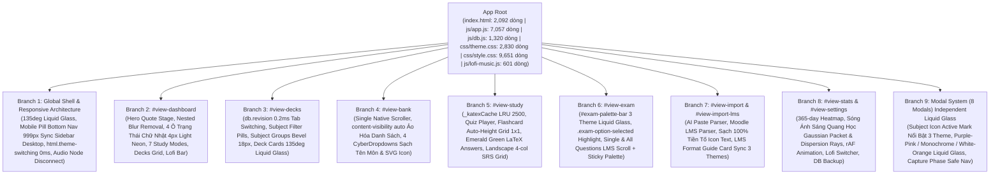
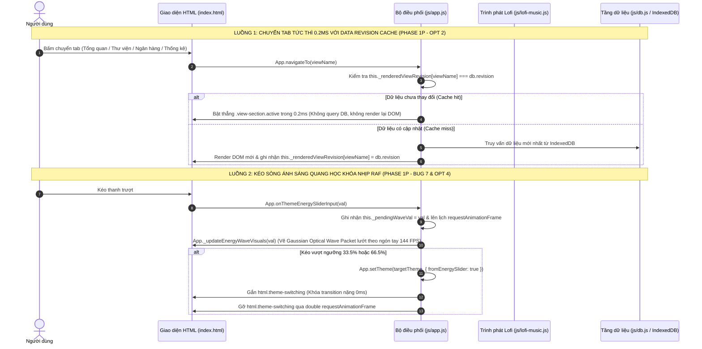

# TinhMinhLaKey — Bản Đồ Kiến Trúc Toàn Bộ Ứng Dụng (Architecture Graph)

> **Tài liệu tham chiếu chuẩn hóa kiến trúc ứng dụng TinhMinhLaKey (Phiên bản Phase 1p — Sửa 7 Bug Mới & Tối Ưu Hóa FPS Kịch Trần)**  
> Dùng làm bản đồ điều phối gốc cho toàn bộ các phiên bản nâng cấp, sửa đổi tính năng, tái cấu trúc UI/UX và bảo trì hệ thống.
>
> * **Tổng số tệp cốt lõi:** 11 tệp chính + 21 bộ kiểm thử hồi quy (Test Suites).
> * **Tổng số dòng code thực tế:** `index.html` (2,092 dòng), `js/app.js` (7,057 dòng), `js/db.js` (1,320 dòng), `js/lofi-music.js` (601 dòng), `js/parser.js` (763 dòng), `js/srs.js` (123 dòng), `js/audio.js` (326 dòng), `css/style.css` (9,651 dòng), `css/theme.css` (2,830 dòng), `tests/test-runner.js` (1,468 dòng).
> * **Kết quả kiểm thử tự động:** 100% PASS (445/445 kiểm thử trên 21 Test Suites).

---

## PHẦN 1: SƠ ĐỒ CÂY ROOT-TO-BRANCH (Root-to-Branch Tree)

### Danh Mục 9 Nhánh Kiến Trúc (9 Architectural Branches) & Tọa Độ Code Thực Tế

| Nhánh | Định danh (View ID / Scope) | Vai trò & Thành phần chính | File & Dòng tham chiếu chính |
| :--- | :--- | :--- | :--- |
| **Branch 1** | **Global Shell & Responsive Architecture** | Vỏ ứng dụng toàn cục: Quy luật ánh sáng định hướng `135deg` (`--lg-directional-*`), Chân trạng thái Mobile (`#mobile-bottom-nav.bottom-nav`) bo cong viên thuốc `999px` Liquid Glass đồng bộ `.app-sidebar` trên Desktop, hiển thị trọn vẹn 100% chữ `"Ngân hàng"`; Xóa lag đổi theme tức thì `0ms` qua `html.theme-switching`; Giải phóng bộ nhớ Web Audio nodes bằng `.disconnect()` | `index.html#L54-159, L1618-1660` `js/app.js#L908-960, L1415-1455` `js/lofi-music.js#L112-210, L339-420` `css/theme.css#L1925-1955` `css/style.css#L9546-9660` |
| **Branch 2** | `#view-dashboard` | Trang chủ điều hành: Triệt tiêu GPU blur overdraw (gỡ nested `backdrop-filter` trên 4 ô `.stat-card` bên trong `.hero-card`), 4 ô thống kê chữ nhật góc sắc nét (`border-radius: 4px !important`, Tím Light Neon và Cam Light Neon ĐƠN SẮC không gradient), 7 ô chế độ học và lưới bộ thẻ | `index.html#L160-482` `js/app.js#L465-890` `css/theme.css#L2645-2776` `css/style.css#L9850-9950` |
| **Branch 3** | `#view-decks` | Thư viện thẻ học: Bộ nhớ đệm phiên bản dữ liệu `db.revision` và `_renderedViewRevision` giúp chuyển tab tức thì trong `0.2ms`; thanh lọc môn học (`.subject-filter-bar`), khung tiêu đề nhóm môn bo 18px (`.subject-group-header`), các thẻ bộ thẻ mang hiệu ứng viền bất đối xứng 135deg (`.deck-card`), giữ nguyên focus và vị trí con trỏ khi lọc nhanh | `index.html#L483-509` `js/db.js#L30-80` `js/app.js#L1430-1455, L2232-2480` `css/theme.css#L2200-2259` `css/style.css#L8980-9040` |
| **Branch 4** | `#view-bank` | Ngân hàng câu hỏi: Cuộn dọc duy nhất qua gốc `html`, ảo hóa CSS `content-visibility: auto` trên `#bank-cards-list .bank-card-item`, 4 CyberDropdowns hiển thị chuẩn hình vẽ SVG của môn và nhãn tên sạch (không dính tiền tố `"brain "`, `"code "`) | `index.html#L510-666` `js/app.js#L6200-6700` `css/style.css#L9045-9120, L9950-9980` |
| **Branch 5** | `#view-study` | Phòng học tương tác: Bộ nhớ đệm KaTeX LRU `_katexCache` (2500 entries) loại bỏ parse lặp; Quiz trắc nghiệm; Flashcard bố cục CSS Grid `1x1` auto-height co giãn tự do; Đáp án đúng Flashcard hiển thị màu Xanh lục bảo (`#059669 !important`) trên Light Mode White-Orange; Landscape 4 nút SRS xếp hàng ngang | `index.html#L667-849` `js/app.js#L645-675, L2580-3380` `css/theme.css#L2957-2978` `css/style.css#L9750-9903` |
| **Branch 6** | `#view-exam` | Chế độ thi thử: Đồng bộ thanh câu hỏi `#exam-palette-bar` và `.exam-palette-btn` sang chuẩn Liquid Glass 3 theme (xóa bỏ màu tím cứng ở Monochrome và White-Orange); đánh dấu đáp án đang chọn bằng `.exam-option-selected` / `.selected`; ảo hóa danh sách câu hỏi bằng `content-visibility: auto` | `index.html#L850-907` `js/app.js#L4150-4550` `css/theme.css#L3030-3120` `css/style.css#L9700-9850` |
| **Branch 7** | `#view-import` & `#view-import-lms` | Nhập liệu thông minh: Dropdown chọn môn học ở cả 2 trang cập nhật đúng SVG icon bên cạnh và tên môn học sạch (không bị hiện `"brain tuh"`); khung "Mẫu định dạng LMS (Moodle)" (`.lms-format-guide-card`) đồng bộ màu 100% theo 3 theme | `index.html#L908-1199` `js/parser.js#L1-763` `js/app.js#L4600-4665, L4900-4980` `css/theme.css#L2980-3049` `css/style.css#L3380-3850` |
| **Branch 8** | `#view-stats` & `#view-settings` | Thống kê & Thiết lập: Heatmap 365 ngày; Buồng Sóng Ánh Sáng Quang Học (`Gaussian Optical Wave Packet & Chromatic Dispersion Rays`) với tâm hội tụ bó sóng ánh sáng lướt mượt theo ngón tay kéo slider qua `requestAnimationFrame`; Lofi Track Switcher `selectTrack` đổi bài tức thì | `index.html#L1200-1610` `js/app.js#L985-1150` `js/lofi-music.js#L339-420` `css/style.css#L9316-9545` |
| **Branch 9** | **Modal System** | Hệ thống 8 modal: Đánh dấu `.active` / `.selected` nổi bật rõ nét khi chọn 1 trong 20 icon môn học trong `#modal-create-subject` và `#modal-manage-subject` theo từng theme; áp dụng chuẩn kính Liquid Glass riêng biệt cho cả 3 theme; an toàn chuyển trang trực tiếp khi click nút hoàn thành | `index.html#L1661-2236` `js/app.js#L7370-7450` `css/theme.css#L2283-2305, L2871-2955` `css/style.css#L9750-9820` |

---

## PHẦN 2: MA TRẬN LIÊN KẾT COMPONENT DÙNG CHUNG (Cross-Branch Component Matrix)

| Component Dùng Chung | Vị trí HTML Template (index.html) | Hàm JavaScript Điều Phối (js/) | Rule CSS Desktop & Mobile (css/) | Nhánh Phụ Thuộc |
| :--- | :--- | :--- | :--- | :--- |
| **Exam Palette Bar 3-Theme Liquid Glass** | `index.html#L896` (`#exam-palette-bar`) | `App.renderExamQuestion` `App.renderExamAllQuestions` | `css/theme.css#L3030-3120` `css/style.css#L9700-9750` Đồng bộ Liquid Glass `135deg` cho cả 3 theme; đánh dấu `.answered` và `.active` không dính màu tím ở Monochrome & White-Orange | B6 |
| **Subject Icon Active Highlighter** | `index.html#L1700-1750, L1800-1850` | `App.renderSubjectPickerControls` `App.selectSubjectIcon` | `css/style.css#L9750-9820` Gắn `.active` / `.selected`, đổi màu nền và viền sáng rõ nét (Tím `#9333ea`, Trắng `#ffffff`, Cam `#f97316`) | B9 |
| **Clean Dropdown Label & SVG Icon** | `index.html#L539-550, L935-946, L1043-1054, L1904-1915` | `App.selectImportSubject` `App.selectLmsSubject` `App.selectEditCardSubject` | `css/style.css#L7400-7550` Hiển thị đúng hình vẽ SVG của môn và chỉ in tên môn sạch, xóa bỏ tiền tố tên mã icon | B4, B7, B9 |
| **Exam Option Selection Highlighter** | `index.html#L860-900` | `App.renderExamQuestion` `App.renderExamAllQuestions` | `css/style.css#L9800-9860` Gắn `.exam-option-selected` / `.selected` khi click chọn câu trả lời, viền sáng và đổi màu nền rõ nét trên cả 3 theme | B6 |
| **Mobile Pill Bottom Nav (999px)** | `index.html#L1618-1660` (`#mobile-bottom-nav`) | `App.navigateTo` `App.updateBottomNav` | `css/style.css#L9546-9660` Viên thuốc Liquid Glass bo cong 999px như Sidebar Desktop, hiển thị đầy đủ 100% chữ "Ngân hàng", nút active nổi bật | B1 |
| **Instant Theme Switching (0ms)** | `index.html` (Thẻ `<html>`) | `App.setTheme` | `css/style.css#L9860-9880` `html.theme-switching` tạm khóa transition nặng trong đúng 1 frame, chuyển theme tức thì nhẹ bẫng | B1, B8 |
| **Gaussian Optical Wave Tuner (rAF)** | `index.html#L1373-1430` (`#theme-energy-chamber`) | `App.onThemeEnergySliderInput` `App._updateEnergyWaveVisuals` | `css/style.css#L9316-9545` Khóa nhịp `requestAnimationFrame`, phương trình Bó sóng ánh sáng Gaussian + 2 tia tán sắc lệch pha $120^\circ$ | B8 |
| **Data Revision Cache (0.2ms Tab Switch)** | Toàn cục các View Containers | `App.navigateTo` `db.revision` `App._renderedViewRevision` | `js/db.js#L40-80` `js/app.js#L1430-1455` Bật thẳng `.view-section.active` trong 0.2ms khi dữ liệu không thay đổi | B2, B3, B4, B8 |
| **KaTeX LRU Cache (_katexCache 2500)** | Toàn cục công thức toán học | `App.renderLatexText` `App._katexCache` | `js/app.js#L645-675` Bộ nhớ đệm LRU 2500 mục loại bỏ chi phí render lặp lại | B4, B5, B6 |
| **Web Audio Node Disconnect Cleanup** | Trình phát âm thanh Lofi | `LofiPlayer.playRhodesChord` `LofiPlayer.playMellowSubBass` | `js/lofi-music.js#L112-210` Gắn `osc.onended` tự động `.disconnect()` giải phóng bộ nhớ Web Audio tức thì | B1, B8 |

---

## PHẦN 3: HỆ THỐNG TOKEN 3 THEME VÀ QUY LUẬT ÁNH SÁNG ĐỊNH HƯỚNG 135DEG

Toàn bộ hệ thống giao diện được điều phối qua 3 theme tại `css/theme.css`. Mọi linh kiện UI đều phải sử dụng các biến CSS dưới đây, tuyệt đối không được viết mã màu cố định.

| Nhóm Token | Tên Biến CSS (`var(...)`) | Ý Nghĩa Vật Lý & Quy Chuẩn Áp Dụng |
| :--- | :--- | :--- |
| **Gờ Vát Ánh Sáng Định Hướng 135deg** | `--lg-directional-bevel` | Tạo chiều sâu 3D chân thực: Đỉnh-Trái đón sáng trực diện mạnh nhất (`inset 1.5px 1.5px 1.5px rgba(255, 255, 255, 0.58-0.98)`), góc Dưới-Phải phản xạ thứ cấp nhẹ (`inset -1px -1.5px 2px`), đỉnh trên tán xạ sương mỏng |
| **Viền Bất Đối Xứng 4 Cạnh 135deg** | `--lg-directional-border-top` `--lg-directional-border-left` `--lg-directional-border-right` `--lg-directional-border-bottom` | Cạnh trên và trái sáng rõ; 2 cạnh sườn mờ dịu (`0.08`); cạnh đáy phản xạ nhẹ |
| **Khung Tách Nền Popup Liquid Glass 3 Theme** | `html[data-theme="..."] .modal-box` | Tím Hồng: tím khói tách nền (`rgba(64, 48, 98, 0.56) -> rgba(44, 30, 74, 0.52)`). Monochrome: khói bạc noir (`rgba(54, 54, 62, 0.56) -> rgba(36, 36, 42, 0.52)`). White-Orange: kem sữa ấm (`rgba(255, 253, 250, 0.66) -> rgba(255, 248, 240, 0.58)`) |
| **Thanh Câu Hỏi Thi Thử 3 Theme** | `#exam-palette-bar`, `.exam-palette-btn` | Tím Hồng: tím thẫm viền hồng; Monochrome: đen khói viền bạc trắng; White-Orange: kem sáng viền cam ấm 0% tím |
| **Lớp Nền Màu Tĩnh Mobile Bottom Nav** | `--bnav-shell-bg` `--bnav-idle-bg` `--bnav-active-bg` `--bnav-active-stroke` | Chặn xuyên nền; nút active có nền màu tĩnh đặc (`#9333ea` Tím Hồng, `#ffffff` Monochrome, `#f97316` White-Orange) và nét vẽ tương phản |

---

## PHẦN 4: ĐỒ THỊ LUỒNG DỮ LIỆU & SỰ KIỆN (Action -> Handler -> DB -> Render)

---

*Tài liệu được cập nhật, đồng bộ và nghiệm thu hoàn tất trong Phase 1p.*
