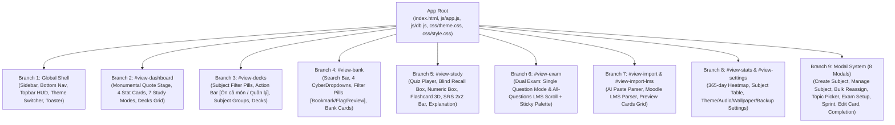
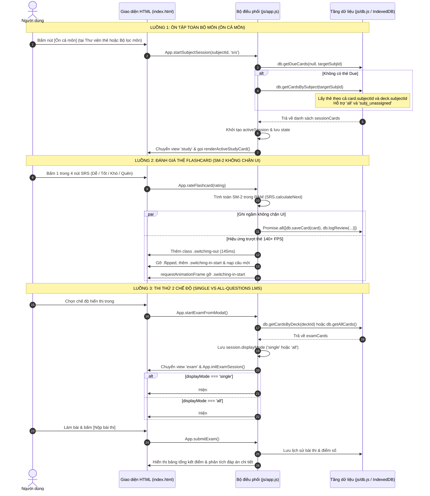

# TinhMinhLaKey — Bản Đồ Kiến Trúc Toàn Bộ Ứng Dụng (Architecture Graph)

> **Tài liệu tham chiếu chuẩn hóa kiến trúc ứng dụng TinhMinhLaKey (Phase 1h)**  
> Dùng làm bản đồ điều phối gốc cho toàn bộ các phiên bản nâng cấp, sửa đổi tính năng, tái cấu trúc UI/UX và bảo trì hệ thống.

---

## PHẦN 1: SƠ ĐỒ CÂY ROOT-TO-BRANCH (Root-to-Branch Tree)

### Danh Mục 9 Nhánh Kiến Trúc (9 Architectural Branches)

| Nhánh | Định danh (View ID / Scope) | Vai trò & Thành phần chính | File & Dòng tham chiếu chính |
| :--- | :--- | :--- | :--- |
| **Branch 1** | **Global Shell** | Sidebar desktop (`.app-sidebar`), Mobile bottom bar (`.bottom-nav`), Topbar HUD capsule (`.topbar-hud-capsule`), Theme Switcher, Toast notifier (`showToast`), Session restore banner | `index.html#L55-150` `js/app.js#L20-150, L400-600` `css/style.css#L100-450` |
| **Branch 2** | `#view-dashboard` | Hero quote monumental stage, 4 ô thống kê bento, 7 thẻ chế độ luyện tập thông minh, lưới bộ thẻ theo môn học | `index.html#L156-320` `js/app.js#L1400-1580` `css/style.css#L850-1350` |
| **Branch 3** | `#view-decks` | Thanh lọc môn học (`.subject-filter-bar`), nút tác vụ môn học (`[Ôn cả môn]`, `[Quản lý môn]`), danh sách nhóm môn (`.subject-group`), thẻ bộ thẻ (`.deck-card`) | `index.html#L321-480` `js/app.js#L1850-2050` `css/style.css#L1400-1750` |
| **Branch 4** | `#view-bank` | Thanh tìm kiếm câu hỏi, 4 CyberDropdown (`Môn`, `Chủ đề`, `Độ khó`, `Nguồn`), 3 nút lọc nhanh (`Bookmark`, `Cờ lỗi`, `Cần ôn`), danh sách câu hỏi ảo hóa | `index.html#L481-620` `js/app.js#L5650-5980` `css/style.css#L1800-2250` |
| **Branch 5** | `#view-study` | Màn hình luyện tập: Quiz trắc nghiệm, hộp đoán trước (Blind Recall), hộp nhập số (Numeric), lật thẻ Flashcard 3D 140+ FPS, thanh đánh giá SRS 2x2, hộp giải thích | `index.html#L621-830` `js/app.js#L2650-3200` `css/style.css#L2500-3100` |
| **Branch 6** | `#view-exam` | Chế độ thi thử 2-Mode: (1) `single`: Từng câu đơn lẻ kèm nút Trước/Sau; (2) `all`: Cuộn dọc như Moodle LMS kèm thanh Palette nhảy câu và nút nộp bài | `index.html#L831-890` `js/app.js#L3400-3850` `css/style.css#L3120-3350` |
| **Branch 7** | `#view-import` & `#view-import-lms` | Nhập câu hỏi tự động: Prompt harness cho AI, bóc tách cấu trúc Moodle LMS raw text, thẻ xem trước câu hỏi có CyberDropdown chọn kiểu/độ khó | `index.html#L891-1050` `js/app.js#L4200-4750` `css/style.css#L3380-3850` |
| **Branch 8** | `#view-stats` & `#view-settings` | Heatmap 365 ngày đóng góp, bảng ma trận thành tích theo môn, thiết lập giao diện (3 theme), hình nền tùy biến, âm thanh, sao lưu/phục hồi IndexedDB | `index.html#L1051-1400` `js/app.js#L5100-5600, L6200-6600` `css/style.css#L3900-4400` |
| **Branch 9** | **Modal System** | Hệ thống 8 modal: Tạo môn, Quản lý môn, Gán lại môn hàng loạt, Chọn môn/chương Mode 5, Cấu hình thi thử, Cấu hình Sprint, Sửa câu hỏi, Hoàn thành bài | `index.html#L1401-2090` `js/app.js#L6640-7050` `css/style.css#L4450-4850` |

---

## PHẦN 2: MA TRẬN LIÊN KẾT COMPONENT DÙNG CHUNG (Cross-Branch Dependency Matrix)

Khi chỉnh sửa bất kỳ Component dùng chung nào, kỹ sư / Agent **phải đối chiếu toàn bộ các nhánh trong bảng ma trận này** để không làm sót giao diện hoặc gây gãy vỡ layout chéo.

| Component Dùng Chung | Vị trí HTML Template (index.html) | Hàm JavaScript sinh HTML & Xử lý (js/app.js) | Rule CSS Desktop & Mobile (css/style.css & theme.css) | Nhánh phụ thuộc |
| :--- | :--- | :--- | :--- | :--- |
| **CyberDropdown** | `index.html#L490-540` (Bank) `index.html#L905-925` (Import) `index.html#L975-995` (LMS) `index.html#L1550-1610` (Exam Setup) `index.html#L1645-1680` (Sprint Setup) `index.html#L1820-1860` (Edit Card) `index.html#L1900-1960` (Manage Subject) `index.html#L1990-2030` (Bulk Reassign) | `App._toggleCyberDropdownById` `App.closeAllCyberDropdowns` `App.selectBankSubject` `App.selectBankTopic` `App.selectBankDifficulty` `App.selectBankSource` `App.selectExamQuestionCount` `App.selectExamTimeLimit` `App.renderLmsPreview` `App.openManageSubjectModal` `App.openBulkReassignModal` | `css/style.css#L6500-6750` (`.cyber-dropdown`, `.cyber-dropdown-trigger`, `.cyber-dropdown-menu`, `.cyber-dropdown-item`) `css/theme.css#L30-65` (`--dropdown-*` tokens) *Quy tắc:* Dropdown mở luôn có `z-index: 1050 !important`, không bao giờ tràn mép màn hình | B1, B4, B6, B7, B9 |
| **Frosted Milky Liquid Glass Box (Modal Box)** | `index.html#L1400-2090` (Toàn bộ 8 modal `.modal-overlay > .modal-box`) | `App._showModal` `App._closeModal` `App.openCreateSubjectModal` `App.openManageSubjectModal` `App.openBulkReassignModal` `App.openTopicPickerModal` `App.openExamSetupModal` | `css/style.css#L3230-3280` (`.modal-overlay`, `.modal-box`) `css/theme.css#L15-45, L180-210, L360-390` (`--glass-slab-*`) *Quy tắc:* `.modal-overlay` có `transform: none !important; backdrop-filter: blur(6px) !important;`; `.modal-box` có `backdrop-filter: blur(44px) saturate(180%) !important; border-radius: 28px !important;` | B9 |
| **Stat Bento Cards** | `index.html#L278-310` (4 ô thống kê dưới Quote) | `App.updateDashboardStats` `App.renderDashboardMetrics` | `css/style.css#L1050-1150` (`.stats-grid`, `.stat-card`, `.stat-num`, `.stat-label`) `css/theme.css#L40-50, L210-220, L390-410` (`--stat-box-*`) *Quy tắc:* Đã xóa `01 //`..`04 //`. Trắng Cam lúc nghỉ là kính trắng kem, hover đổi sang màu cam đào `--stat-box-hover-bg` | B2 |
| **Study Mode Cards** | `index.html#L330-370` (7 ô chế độ học) | `App.startSession(deckId, mode)` | `css/style.css#L1200-1320` (`.study-mode-cards-grid`, `.study-mode-card`) `css/theme.css#L45-55, L220-230, L400-420` (`--card-frosted-*`) *Quy tắc:* Không gắn inline background/color; hover kính trong hơn (`alpha ~0.48`) kèm viền sáng | B2 |
| **Deck Cards Grid** | `index.html#L380-420` (Dashboard preview) `index.html#L440-475` (Decks library) | `App.renderDecks` `App.renderDashboardDecks` | `css/style.css#L1500-1650` (`.decks-grid`, `.deck-card`, `.deck-card-header`) `css/theme.css#L45-55, L220-230, L400-420` (`--card-frosted-*`) | B2, B3 |
| **Bookmark & Flag Active States** | `index.html#L640-660` (Quiz actions) `index.html#L750-770` (Flashcard actions) `index.html#L580-600` (Bank card actions) | `App.toggleCurrentCardBookmark` `App.toggleCurrentCardFlag` `App.toggleBankCardBookmark` `App.toggleBankCardFlag` `App.updateStudyCardActionsUI` `App.renderQuestionBankCardItem` | `css/style.css#L2680-2720, L2050-2090` *Quy tắc:* Chưa chọn: icon rỗng nét mảnh stroke. Đã đánh dấu: icon bôi đặc 100% (`fill: currentColor !important`), nền nút màu vàng hổ phách (`#f59e0b`) hoặc đỏ san hô (`#ef4444`) nổi bật | B4, B5 |
| **Flashcard 3D Stage & SRS Rating Bar** | `index.html#L700-790` (Flashcard container, stage, card, face, back, rating bar) | `App.flipFlashcard` `App.rateFlashcard` `App.renderActiveStudyCard` | `css/style.css#L2740-2920` (`.flashcard-stage`, `.flashcard-card`, `.flashcard-face`, `.flashcard-back`, `.switching-out`, `.switching-in-start`, `.flashcard-ratings`) *Quy tắc:* `.flashcard-face` có `backdrop-filter: none;` để giữ 140+ FPS; `rateFlashcard` chuyển câu trượt mượt mà không khựng | B5 |
| **Exam Dual-Mode Player** | `index.html#L831-870` (`#exam-single-card-wrap`, `#exam-all-questions-wrap`, `#exam-palette-bar`, `#exam-all-questions-list`) | `App.startExamFromModal` `App.initExamSession` `App.renderExamQuestion` `App.renderExamAllQuestions` `App.submitExam` | `css/style.css#L3150-3300` (`.exam-palette-bar`, `.exam-palette-btn`, `.exam-lms-item`) *Quy tắc:* Hỗ trợ cả 2 chế độ (Single vs All Questions LMS Scroll kèm sticky Question Palette) | B6 |
| **Subject Badge & Pill** | `index.html#L330-360` (Dashboard & Decks) `index.html#L500-520` (Bank) `index.html#L1120-1160` (Stats) | `App.renderSubjectIcon` `App.renderDecks` `App.renderQuestionBank` | `css/style.css#L1420-1480` (`.subject-badge`, `.subject-badge-icon`, `.subject-filter-chip`) `css/theme.css#L55-70, L235-250, L420-440` (`--subject-pill-*`) | B2, B3, B4, B8, B9 |

---

## PHẦN 3: ĐỒ THỊ LUỒNG DỮ LIỆU & HÀNH ĐỘNG (Action -> Handler -> DB -> Render)

---

## PHẦN 4: DANH MỤC TOKEN THIẾT KẾ TRUNG TÂM (`css/theme.css` Token Registry)

Toàn bộ hệ thống giao diện được điều phối qua 3 theme tại `css/theme.css`. Mọi linh kiện UI đều phải sử dụng các biến CSS dưới đây, tuyệt đối không được viết mã màu cố định.

| Nhóm Token | Tên biến CSS (`var(...)`) | Ý nghĩa & Quy chuẩn áp dụng |
| :--- | :--- | :--- |
| **Nền Kính Liquid Glass** | `--glass-slab-bg` `--glass-slab-border` `--glass-slab-shadow` `--glass-slab-blur` | Nền kính Frosted Milky Liquid Glass cho `.modal-box`, `.app-sidebar`, HUD capsule. Độ mờ `blur(44px) saturate(180%)`, specular highlight `inset 0 1.5px 2px`. |
| **Thẻ Card Kính Mờ** | `--card-frosted-bg` `--card-frosted-border` `--card-frosted-shadow` `--card-frosted-blur` | Nền thẻ kính mờ cho 4 ô thống kê, 7 ô chế độ học, thẻ bộ thẻ, thẻ câu hỏi ngân hàng. |
| **Hover Ô Thống Kê** | `--stat-box-hover-bg` `--stat-box-hover-border` `--stat-box-hover-shadow` `--stat-box-hover-color` | Trạng thái hover của 4 ô thống kê dưới Quote: Ở Mode Trắng Cam chuyển sang màu cam đào ấm áp hiện đại. |
| **Spotlight Tương Tác** | `--spotlight-color-1` `--spotlight-color-2` | Dải ánh sáng hover động quanh viền thẻ và nút bấm. Đồng bộ triệt để theo từng theme (không còn ánh tím ở Trắng Đen / Trắng Cam). |
| **Huy Hiệu Môn Học** | `--subject-pill-bg` `--subject-pill-color` `--subject-pill-border` | Màu nền, chữ và viền cho các badge môn học, thanh lọc môn học và bảng thống kê. |
| **Ô Nhập Liệu & Chữ Gợi Ý** | `--input-bg` `--input-border` `--input-text` `--input-placeholder` | Đồng nhất 100% font Sans-serif (`Plus Jakarta Sans`), cỡ chữ `0.95rem`, độ tương phản cao, xóa hoàn toàn Monospace. |
| **Typography Quote** | `--font-poster` `--font-editorial` `--font-sans` | Montserrat 900 Black cho Chữ Quote To bản; Newsreader / PT Serif weight 600 đứng thẳng cho chữ quote phụ ở Trắng Cam; Plus Jakarta Sans cho toàn bộ thân trang. |

---
*Tài liệu được sinh tự động và nghiệm thu hoàn tất trong Phase 1h.*
