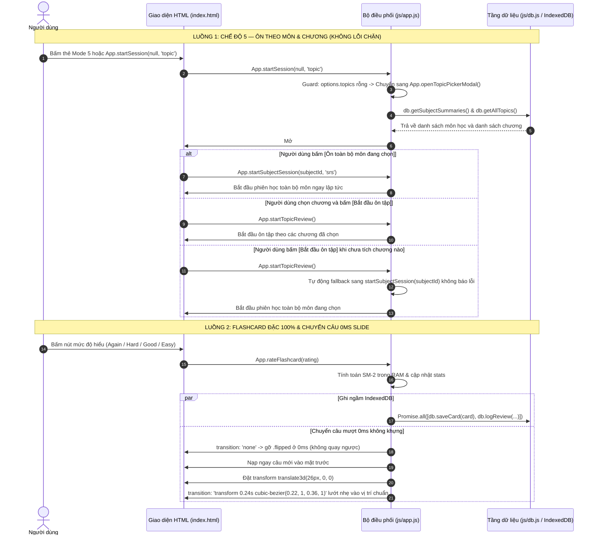

# TinhMinhLaKey — Bản Đồ Kiến Trúc Toàn Bộ Ứng Dụng (Architecture Graph)

> **Tài liệu tham chiếu chuẩn hóa kiến trúc ứng dụng TinhMinhLaKey (Phase 1i)**  
> Dùng làm bản đồ điều phối gốc cho toàn bộ các phiên bản nâng cấp, sửa đổi tính năng, tái cấu trúc UI/UX và bảo trì hệ thống.

---

## PHẦN 1: SƠ ĐỒ CÂY ROOT-TO-BRANCH (Root-to-Branch Tree)

```mermaid
graph TD
    Root["App Root<br/>(index.html, js/app.js, js/db.js, css/theme.css, css/style.css, js/audio.js)"]

    Root --> B1["Branch 1: Global Shell & Lens Optical Layer<br/>(Liquid Glass Lens Filter SVG feDisplacementMap, Sidebar, Bottom Nav, Topbar HUD, Theme Switcher, Toaster)"]
    Root --> B2["Branch 2: #view-dashboard<br/>(Monumental Quote Stage [PT Serif/Newsreader ở Trắng Cam], 4 Stat Cards, 7 Study Modes, Decks Grid)"]
    Root --> B3["Branch 3: #view-decks<br/>(Subject Filter Pills, Action Bar [Ôn cả môn / Quản lý], Subject Groups, Decks)"]
    Root --> B4["Branch 4: #view-bank<br/>(Search Bar [Visible Frame], 4 CyberDropdowns, Filter Pills [Bookmark/Flag/Review], Bank Cards)"]
    Root --> B5["Branch 5: #view-study<br/>(Quiz Player, Blind Recall Box, Numeric Box, Flashcard Opaque Solid [0ms Slide], SRS 2x2 Bar, Explanation)"]
    Root --> B6["Branch 6: #view-exam<br/>(Dual Exam: Single Question Mode & All-Questions LMS Scroll + Sticky Palette)"]
    Root --> B7["Branch 7: #view-import & #view-import-lms<br/>(AI Paste Parser, Moodle LMS Parser, Preview Cards Grid, Inputs & Textareas with High Contrast Borders)"]
    Root --> B8["Branch 8: #view-stats & #view-settings<br/>(365-day Heatmap, Subject Table, Theme/Audio Acoustic Glass Marimba/Wallpaper/Backup Settings)"]
    Root --> B9["Branch 9: Modal System (8 Modals) with Convex Meniscus Liquid Glass Rim<br/>(Create Subject, Manage Subject, Bulk Reassign, Topic Picker Mode 5, Exam Setup, Sprint, Edit Card, Completion)"]
```

### Danh Mục 9 Nhánh Kiến Trúc (9 Architectural Branches)

| Nhánh | Định danh (View ID / Scope) | Vai trò & Thành phần chính | File & Dòng tham chiếu chính |
| :--- | :--- | :--- | :--- |
| **Branch 1** | **Global Shell & Lens Layer** | Bộ lọc thấu kính lồi khúc xạ SVG (`#liquid-convex-lens` với `<feDisplacementMap>`), Sidebar desktop (`.app-sidebar` bán trong suốt `0.48-0.58`), Mobile bottom bar (`.bottom-nav`), Khóa bảo vệ SVG icon (`fill: none !important`), Toaster, Session restore banner | `index.html#L55-150, L1525-1560` `js/app.js#L156-235` `css/theme.css#L1340-1390` |
| **Branch 2** | `#view-dashboard` | Hero quote monumental stage (Montserrat 900 Black ở Dark Mode, PT Serif / Newsreader 700 thẳng đứng ở Trắng Cam), 4 ô thống kê bento (nghỉ: đục `0.85`, hover: đơn sắc `#9333ea`, `#ffffff`, `#ea580c`), 7 thẻ chế độ học (nghỉ: đục `0.90`, hover: trong suốt `0.34`), lưới bộ thẻ theo môn | `index.html#L156-435` `css/theme.css#L1375-1430` `css/style.css#L850-1350` |
| **Branch 3** | `#view-decks` | Thanh lọc môn học (`.subject-filter-bar`), nút tác vụ môn học (`[Ôn cả môn]`, `[Quản lý môn]`), danh sách nhóm môn (`.subject-group`), thẻ bộ thẻ (`.deck-card`) | `index.html#L436-580` `js/app.js#L1940-2050` `css/style.css#L1400-1750` |
| **Branch 4** | `#view-bank` | Khung tìm kiếm câu hỏi có viền rõ nét 100% trong Dark Mode, 4 CyberDropdown (`Môn`, `Chủ đề`, `Độ khó`, `Nguồn`), 3 nút lọc nhanh (`Bookmark`, `Cờ lỗi`, `Cần ôn`), danh sách câu hỏi ảo hóa | `index.html#L581-720` `css/theme.css#L1435-1460` `css/style.css#L1800-2250` |
| **Branch 5** | `#view-study` | Màn hình luyện tập: Quiz trắc nghiệm (KaTeX `1.22em`, đáp án `min-height: 62px`), nút đoán trước Active chữ tương phản `#09090b`, Flashcard Nền Đặc 100% (`--flashcard-solid-bg`) không lộ đáp án mặt sau, chuyển câu tức thì `0ms` slide từ `translate3d(26px, 0, 0)`, thanh đánh giá SRS 2x2 | `index.html#L721-830` `js/app.js#L3130-3180` `css/style.css#L2880-2950, L5150-5200` |
| **Branch 6** | `#view-exam` | Chế độ thi thử 2-Mode: (1) `single`: Từng câu đơn lẻ kèm nút Trước/Sau; (2) `all`: Cuộn dọc như Moodle LMS kèm thanh Palette nhảy câu và nút nộp bài | `index.html#L831-890` `js/app.js#L3400-3850` `css/style.css#L3120-3350` |
| **Branch 7** | `#view-import` & `#view-import-lms` | Nhập câu hỏi tự động: Prompt harness cho AI, bóc tách cấu trúc Moodle LMS raw text, thẻ xem trước câu hỏi có CyberDropdown chọn kiểu/độ khó, các khung nhập liệu và textarea viền sáng sắc nét trên nền tối | `index.html#L891-1050` `css/theme.css#L1435-1460` `css/style.css#L3380-3850` |
| **Branch 8** | `#view-stats` & `#view-settings` | Heatmap 365 ngày đóng góp, bảng ma trận thành tích theo môn, thiết lập giao diện (3 theme), hình nền tùy biến, hệ thống âm thanh Acoustic Glass & Wooden Marimba harmonic synthesis (`js/audio-config.js` & `js/audio.js`), sao lưu/phục hồi IndexedDB | `index.html#L1051-1400` `js/audio.js` `js/audio-config.js` |
| **Branch 9** | **Modal System** | Hệ thống 8 modal: Thấu kính lồi khúc xạ viền + Vành Meniscus 3D `::before` (`mask-composite: exclude`): Tạo môn, Quản lý môn, Gán lại môn hàng loạt, Chọn môn/chương Mode 5 (có nút "Ôn toàn bộ môn đang chọn", tự động ôn không chặn lỗi), Cấu hình thi thử, Cấu hình Sprint, Sửa câu hỏi, Hoàn thành bài | `index.html#L1401-2090` `js/app.js#L3510-3660` `css/theme.css#L1360-1410` |

---

## PHẦN 2: MA TRẬN LIÊN KẾT COMPONENT DÙNG CHUNG (Cross-Branch Dependency Matrix)

Khi chỉnh sửa bất kỳ Component dùng chung nào, kỹ sư / Agent **phải đối chiếu toàn bộ các nhánh trong bảng ma trận này** để không làm sót giao diện hoặc gây gãy vỡ layout chéo.

| Component Dùng Chung | Vị trí HTML Template (index.html) | Hàm JavaScript sinh HTML & Xử lý (js/app.js) | Rule CSS Desktop & Mobile (css/style.css & theme.css) | Nhánh phụ thuộc |
| :--- | :--- | :--- | :--- | :--- |
| **Convex Meniscus Liquid Glass (Modal Box & Sidebar)** | `index.html#L1400-2090` (Toàn bộ 8 modal `.modal-overlay > .modal-box`) `index.html#L55-120` (`.app-sidebar`) | `App.initLiquidGlassLensFilter` `App._showModal` `App._closeModal` | `css/theme.css#L1360-1410` `backdrop-filter: url(#liquid-convex-lens) blur(32px) saturate(190%) !important;` `modal-box::before` vành meniscus `mask-composite: exclude;` `.app-sidebar` bán trong suốt `0.48-0.58` | B1, B9 |
| **Flashcard Opaque Face & 0ms Slide Transition** | `index.html#L750-785` (Flashcard front, back, stage) | `App.flipFlashcard` `App.rateFlashcard` `App.renderActiveStudyCard` | `css/style.css#L2880-2950` `background: var(--flashcard-solid-bg) !important;` `visibility: hidden; opacity: 0;` ở mặt úp ngăn lộ đáp án 100%. `rateFlashcard` 0ms reset 0deg và slide nhẹ `26px` | B5 |
| **Mode 5 Subject & Topic Picker** | `index.html#L1665-1690` (`#modal-topic-picker`) | `App.openTopicPickerModal` `App.filterPickerTopicsBySubject` `App.toggleTopicSelection` `App.toggleAllTopicsInPicker` `App.startTopicReview` `App.startSession` | `css/style.css#L3510-3600` Nút "Ôn toàn bộ môn đang chọn". Khi bấm "Bắt đầu ôn tập" với 0 topics được tích, tự động học cả môn qua `startSubjectSession` | B2, B9 |
| **Protected Navigation Icons (SVG Stroke Only)** | `index.html#L60-115` (`.app-sidebar`) `index.html#L1525-1560` (`.bottom-nav`) | Render trực tiếp trong HTML / `App.getMonoSvg` | `css/theme.css#L1345-1365` Khóa `fill: none !important; stroke: currentColor !important; background: transparent !important;` ngăn icon biến thành cục vuông | B1 |
| **CyberDropdown** | `index.html#L490-540` (Bank) `index.html#L905-925` (Import) `index.html#L975-995` (LMS) `index.html#L1550-1610` (Exam Setup) `index.html#L1645-1680` (Sprint Setup) `index.html#L1820-1860` (Edit Card) `index.html#L1900-1960` (Manage Subject) `index.html#L1990-2030` (Bulk Reassign) | `App._toggleCyberDropdownById` `App.closeAllCyberDropdowns` `App.selectBankSubject` | `css/style.css#L6500-6750` `css/theme.css#L850-890` | B1, B4, B6, B7, B9 |
| **Acoustic Glass & Marimba Audio System** | Gọi toàn cục khi tương tác UI / học bài | `sounds.playTabWhoosh` `sounds.playFlip` `sounds.playCorrect` `sounds.playIncorrect` `sounds.playFanfare` `sounds.playBatteryCharged` | `js/audio-config.js` `js/audio.js` Harmonic synthesis sine + triangle ADSR, loại bỏ 100% sóng vuông 8-bit chát chúa | Toàn bộ ứng dụng |
| **LaTeX & KaTeX Scaling** | Toàn bộ câu hỏi, đáp án, giải thích trong Quiz, Flashcard, Bank | `App.renderLatexText` `App.adaptOptionsLayout` | `css/style.css#L2314-2330` `font-size: 1.22em - 1.26em !important;` Khôi phục `\theta`, `\frac`, `\beta`, `\rho` và nâng `\frac` thành `\dfrac` | B4, B5, B6 |
| **Focus Mode Centering** | Khi bật chế độ tập trung (`body.focus-mode-active`) | `App.toggleFocusMode` | `css/style.css#L5150-5200` `.quiz-container` căn giữa `margin: 48px auto 0 auto`, nút thoát cố định `top: 20px; left: 24px` | B5 |

---

## PHẦN 3: ĐỒ THỊ LUỒNG DỮ LIỆU & HÀNH ĐỘNG (Action -> Handler -> DB -> Render)

---

## PHẦN 4: DANH MỤC TOKEN THIẾT KẾ TRUNG TÂM (`css/theme.css` Token Registry)

Toàn bộ hệ thống giao diện được điều phối qua 3 theme tại `css/theme.css`. Mọi linh kiện UI đều phải sử dụng các biến CSS dưới đây, tuyệt đối không được viết mã màu cố định.

| Nhóm Token | Tên biến CSS (`var(...)`) | Ý nghĩa & Quy chuẩn áp dụng |
| :--- | :--- | :--- |
| **Thấu Kính Lồi Khúc Xạ & Vành Meniscus** | `--modal-convex-bg` `--modal-convex-border` `--sidebar-glass-bg` `--sidebar-glass-border` | Bộ lọc `<filter id="liquid-convex-lens">` (`<feDisplacementMap>`) bóp méo viền + vành `::before` meniscus (`mask-composite: exclude`). Sidebar mờ trong suốt `0.48-0.58` + `blur(38px) saturate(190%)`. |
| **Mặt Thẻ Flashcard Nền Đặc 100%** | `--flashcard-solid-bg` `--flashcard-solid-border` | Nền đặc 100% cho `.flashcard-face`, `.flashcard-front`, `.flashcard-back`. Loại bỏ triệt để xuyên thấu 3D của Chromium. White-Orange dùng `#fffcf8` viền cam ấm. |
| **Thẻ Card Kính Mờ (Resting vs Hover)** | `--card-frosted-bg` `--card-frosted-hover-bg` `--card-frosted-border` | Nghỉ: độ đục cao `0.88-0.90` + `blur(48px)`. Hover: trong suốt hơn hẳn (`opacity 0.34`) tương phản nổi bật. |
| **Hover 4 Ô Thống Kê Đơn Sắc** | `--stat-box-hover-bg` `--stat-box-hover-border` `--stat-box-hover-text` | Trạng thái hover của 4 ô thống kê dưới Quote: 100% Đơn sắc hiện đại (`#9333ea` tím, `#ffffff` trắng, `#ea580c` cam), zero gradients. |
| **Khung Nhập Liệu Rõ Nét Dark Mode** | `--input-box-bg` `--input-box-border` | Khôi phục 100% viền và nền rõ nét cho `#bank-search-input`, `#import-deck-name`, `#import-deck-desc`, `#import-raw-input`, `#lms-raw-input` trên cả 3 theme. |
| **Typography Quote Trắng Cam** | `html[data-theme="white-orange"] #hero-title` | Chữ đen to bản (`.hero-title-main`, `.hero-title-sub`) dùng `PT Serif` / `Newsreader` weight 700 đứng thẳng (`font-style: normal !important; color: #1c1917 !important;`). |
| **Tương Phản Đoán Trước & Câu Sai Monochrome** | `#btn-toggle-blind.active` `.quiz-option-btn.correct` `.quiz-option-btn.incorrect` | Nút Đoán trước active chữ `#09090b` đậm nét. Monochrome: câu đúng viền xanh 8px phát sáng; câu sai sọc chéo đỏ thẫm + thanh trái 8px + gạch ngang chữ. |

---
*Tài liệu được cập nhật và nghiệm thu hoàn tất trong Phase 1i.*
